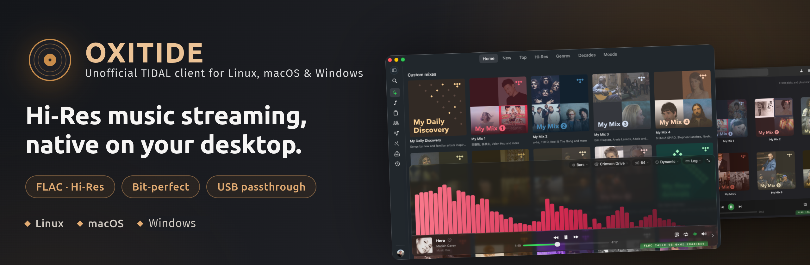

[](https://github.com/yelanxin/OxiTide/releases)

<p align="center">
  
</p>

<h1 align="center">OxiTide</h1>

**OxiTide** is a bit-perfect, high-resolution music player for Linux, macOS and Windows, written in Rust — a GTK4 front-end on Linux, a native SwiftUI front-end on macOS, a native WinUI 3 one on Windows, all on the same playback engine. It plays **your own music library** — FLAC, APE, WAV, MP3 and more, CUE sheets included — untouched, straight to your DAC. It can stream **TIDAL** through the same engine too.

It is the native successor to [hiresTI](https://github.com/yelanxin/hiresTI) — same bit-perfect playback engine, same USB Rawlink direct-to-DAC output, rebuilt from the ground up with a native Rust UI: faster startup, lower memory, no Python runtime.

## Highlights

- **Bit-perfect playback** — untouched PCM straight to your DAC
- **Your music library** — FLAC, APE, WAV, MP3 and more, CUE sheets, tag editing and artwork, see [below](#local-music)
- **USB Rawlink** (Linux) — direct USB audio transport, bypassing the OS mixer entirely
- **CoreAudio Exclusive mode** (macOS) — hog mode plus integer mode, the DAC's native rate and format
- **WASAPI Exclusive mode** (Windows) — the system mixer out of the path, the device at the track's own rate and bit depth
- **TIDAL streaming** (optional) — Hi-Res / FLAC with gapless playback, see [below](#tidal-streaming)
- **Native performance** — a single self-contained binary, instant startup
- Spectrum visualizer, level meter, synced lyrics, MPRIS integration

## Local music

Add your music folders under **Local Music** — no account, no sign-in. On
Windows a first launch opens straight into it; on Linux and macOS pick
**Local Music** from the account button at the bottom of the sidebar.

- **Formats:** FLAC, APE (Monkey's Audio), WAV, AIFF, ALAC, AAC, MP3 and Ogg
  Vorbis, all played bit-perfect
- **CUE sheets**, external (UTF-8, UTF-16, GBK) or embedded in FLAC / APE —
  each track plays, seeks and advances like a separate file
- **A full library:** Albums, Tracks, Artists, Playlists, search, Favorites
  and History; multi-disc albums are one album, playlists can sit in folders
  and take a cover of your own
- **Browse Files:** your folders as they are on disk — edit tags one file or
  many at once (CUE sheets too), move files to the Trash (the Recycle Bin on
  Windows)
- **Artwork:** folder and embedded covers, optional automatic download of
  missing album covers and artist pictures, or pick one yourself — from a file
  or from every match found online
- Lyrics from `.lrc` files or the tags; the library rescans at startup

Snap users with music on external drives run
`sudo snap connect oxitide:removable-media` once.

## TIDAL streaming

With a TIDAL subscription OxiTide also streams Hi-Res and lossless FLAC,
gapless, through the same bit-perfect engine. Switch between Local Music and
TIDAL from the account button at the bottom of the sidebar; each keeps its
own library and history, and switching back keeps you signed in.

TIDAL is built into the Linux and macOS builds and the Windows downloads on
[Releases](https://github.com/yelanxin/OxiTide/releases). The Microsoft Store
build adds it with the
[TIDAL plugin](https://github.com/yelanxin/oxitide-tidal-plugin).

Browsing and playback are the same on all three platforms; a few extras are
still Linux-only. The [feature matrix and roadmap](ROADMAP.md) tracks what
each build has today and what is coming next.

**Linux** — GTK4 / libadwaita. The window is decorated by your desktop, so the
title bar matches the rest of KDE or GNOME.

*GNOME*


*KDE Plasma*


**macOS** — SwiftUI


**Windows** — WinUI 3


## Install

OxiTide is **free to use**. Packages for every supported distribution, the
macOS app and the Windows build are on the
[**Releases**](https://github.com/yelanxin/OxiTide/releases) page; on
Windows it is also in the
[**Microsoft Store**](https://apps.microsoft.com/detail/9NDB0J7K3TCB?referrer=appbadge&mode=direct).

### macOS

macOS 14 or later; Apple silicon and Intel in one bundle.

```bash
curl -fsSL https://raw.githubusercontent.com/yelanxin/OxiTide/main/install.sh | bash
```

Downloads the newest build, verifies its checksum, puts `OxiTide.app` in
Applications and clears it to open. Re-run it to update.

By hand instead: unzip `OxiTide-<ver>-macos-universal.zip` from
[Releases](https://github.com/yelanxin/OxiTide/releases) into Applications.
The build is not notarized yet, so the first launch needs **System Settings
→ Privacy & Security → Open Anyway**.

The project does not have an Apple Developer membership yet, which is what
signing and notarizing require. [Sponsorship](https://github.com/sponsors/yelanxin)
is very welcome and goes towards it: with the membership in place the macOS
build will be signed, and it will open without any warning.

For bit-perfect playback turn on **Exclusive access** in Settings → Audio:
OxiTide takes the device in CoreAudio hog mode and runs it at the track's own
rate and bit depth. Settings and login live in
`~/Library/Application Support/OxiTide`, logs in
`~/Library/Logs/OxiTide/oxitide.log`.

A few of the Linux build's extras are not ported yet — the
[feature matrix](ROADMAP.md) tracks what each build has.

### Windows

Windows 10 (1809 or later) or Windows 11, 64-bit.

#### Microsoft Store

<a href="https://apps.microsoft.com/detail/9NDB0J7K3TCB?referrer=appbadge&mode=direct"></a>

Signed by Microsoft, so it opens without a SmartScreen warning, and the Store
keeps it up to date. The Store build plays local music; TIDAL streaming is a
separate plugin — see
[oxitide-tidal-plugin](https://github.com/yelanxin/oxitide-tidal-plugin) to
add it.

#### Installer or portable zip

Two downloads on the
[Releases](https://github.com/yelanxin/OxiTide/releases) page, both with
TIDAL included and neither needing a runtime installed first:

| Download | What it does |
|---|---|
| `OxiTide-<ver>-windows-x64.exe` | Installs into Program Files, with a Start menu entry and an uninstall entry |
| `OxiTide-<ver>-windows-x64-portable.zip` | Unzip and run `OxiTide.exe` from anywhere — nothing is installed |

These builds are not code-signed yet, so the first launch shows **"Windows
protected your PC"**: choose **More info → Run anyway** (or install from the
Microsoft Store above).

The project does not have a code-signing certificate yet.
[Sponsorship](https://github.com/sponsors/yelanxin) is very welcome and goes
towards one: a signed build no longer trips SmartScreen.

Output goes through **WASAPI**, shared with other apps on a first run. For
bit-perfect playback turn on **exclusive mode** in **Settings → Output**: the
system mixer is out of the path and the device runs at the track's own rate
and bit depth.
Settings, the session token and the local music library live in
`%APPDATA%\OxiTide`; the cover cache and the engine's `oxitide.log` in
`%LOCALAPPDATA%\OxiTide`.

The Now Playing page, the visualizer, the DSP chain, scrobbling, media keys
and the tray icon are not ported yet — the [feature matrix](ROADMAP.md)
tracks what each build has.

### Linux

#### Quick install

```bash
curl -fsSL https://raw.githubusercontent.com/yelanxin/OxiTide/main/install.sh | bash
```

Detects your distribution, downloads the matching package from the newest
release that has one, and installs it with your native package manager
(x86_64: Arch, Debian 13+, Ubuntu 24.04+, Fedora 43+, openSUSE Tumbleweed
— and their derivatives). The same script installs the macOS build on a Mac.

#### Snap

[](https://snapcraft.io/oxitide)

Available on any distribution with snapd:

```bash
sudo snap install oxitide
```

If audio output or your USB DAC is not detected, connect the audio interfaces
once (not needed after the store enables auto-connection):

```bash
sudo snap connect oxitide:alsa
sudo snap connect oxitide:raw-usb
```

#### Flatpak

Available on any distribution from the official OxiTide Flatpak repository
([flatpak.oxitide.com](https://flatpak.oxitide.com)):

```bash
flatpak install --user https://flatpak.oxitide.com/oxitide.flatpakref
```

Launch it from the app menu, or with
`flatpak run io.github.yelanxin.OxiTide`. The GNOME runtime is fetched from
Flathub automatically. For bit-perfect USB Rawlink output the app asks you to
install a one-line udev rule on first use (the Flatpak sandbox cannot install
it itself).

#### Manual install

| Distribution | Install |
|---|---|
|  Arch Linux / Manjaro / CachyOS | `yay -S oxitide-bin` (AUR: [oxitide-bin](https://aur.archlinux.org/packages/oxitide-bin)) — or `sudo pacman -U oxitide-<ver>-1-x86_64_archlinux.pkg.tar.zst` |
|  Debian 13+ | `sudo apt install ./oxitide_<ver>_amd64_debian13.deb` |
|  Ubuntu 24.04 / 26.04 | `sudo apt install ./oxitide_<ver>_amd64_ubuntu2404.deb` (or `_ubuntu2604.deb`) |
|  Fedora 43 / 44 | `sudo dnf install ./oxitide-<ver>-1.fedora.x86_64_fedora44.rpm` (or `_fedora43.rpm`) |
|  openSUSE Tumbleweed | `sudo zypper install ./oxitide-<ver>-1.opensuse.x86_64_opensuse_tumbleweed.rpm` |

Requirements: GTK 4.14+ and, for streaming, a TIDAL subscription (local music needs none) (Debian 12 is not supported).
For bit-perfect USB Rawlink output the package installs a udev rule and a polkit
action so the app can claim your DAC — the first use asks for authorization.

Settings and login live in `~/.config/oxitide`, so OxiTide installs cleanly
alongside hiresTI.

#### Updating

Re-run the quick-install command above (it always picks the latest release and
upgrades in place), or download the new package and install it the same way.
AUR: `yay -Syu`. Flatpak: `flatpak update`. Snap updates automatically. The app also checks for new
releases itself (**Check for Updates** in the menu).

## License

OxiTide is proprietary freeware — free to download and use, not open source.
Redistribution of modified binaries is not permitted. Third-party open-source
components are acknowledged in the `THIRD-PARTY-NOTICES` file shipped with each release.

Looking for the open-source edition? The Python/GTK version lives on at
[hiresTI](https://github.com/yelanxin/hiresTI) (GPL-3.0).

## Feedback

Bug reports and feature requests are welcome in the
[Issues](https://github.com/yelanxin/OxiTide/issues) of this repository.


---

*OxiTide is an independent project and is not affiliated with or endorsed by TIDAL.*

