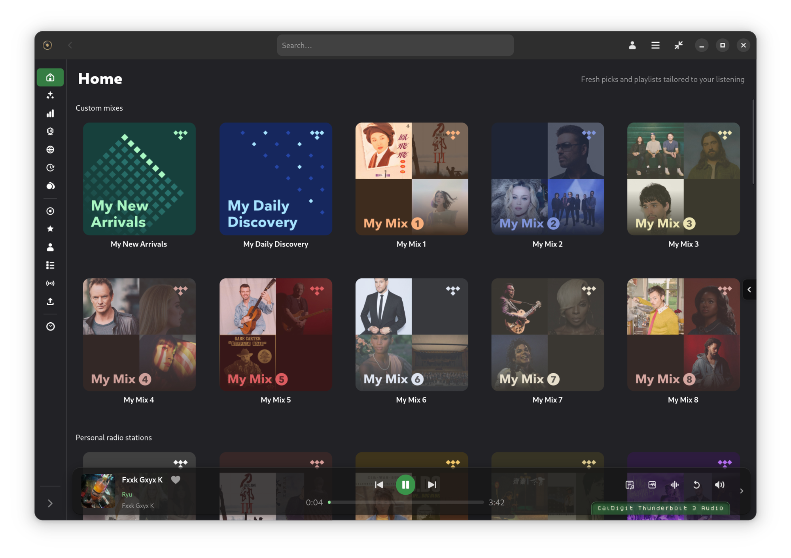
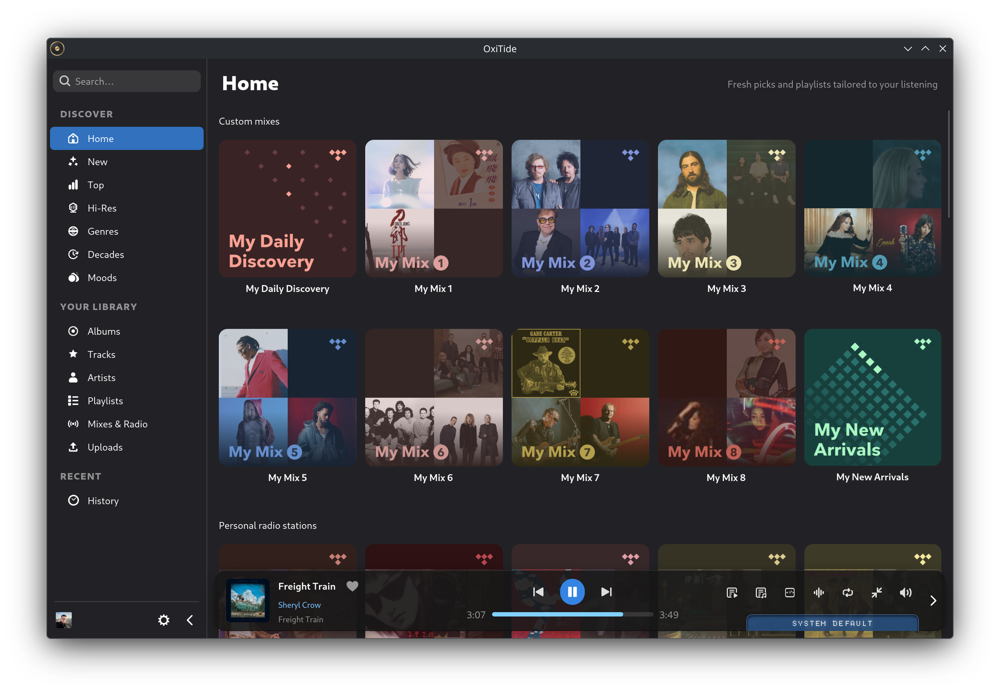
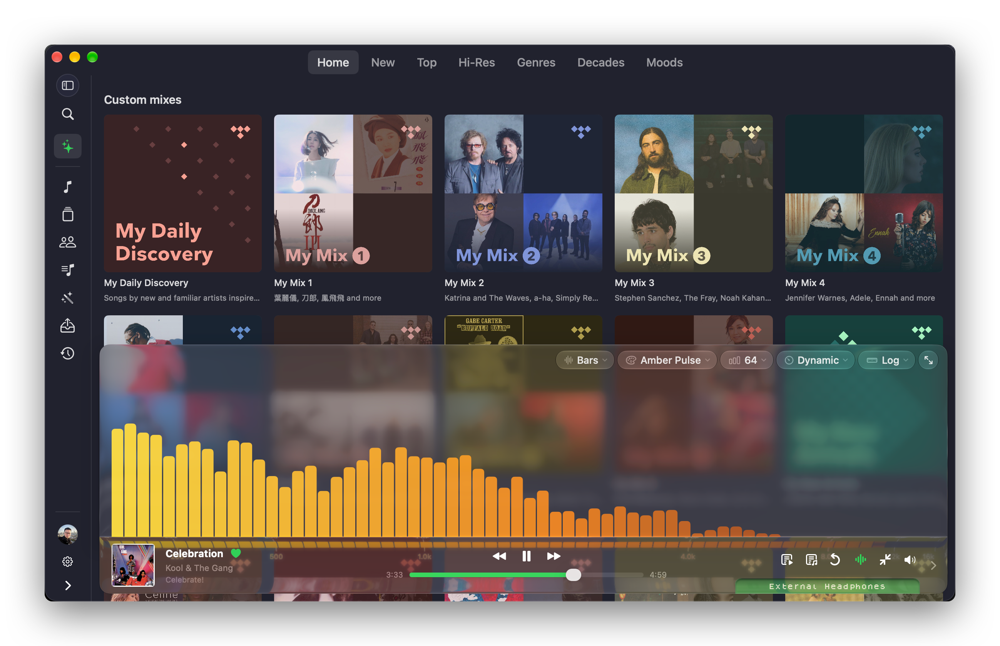
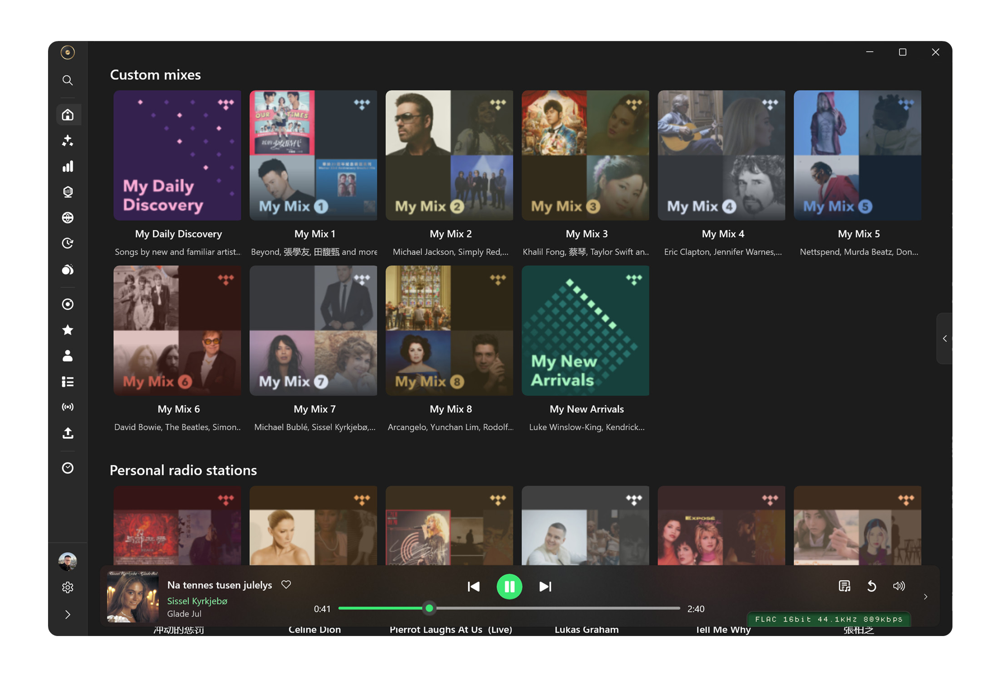

[](https://github.com/yelanxin/OxiTide/releases)

<p align="center">
  
</p>

<h1 align="center">OxiTide</h1>

**OxiTide** is a bit-perfect, high-resolution music player for Linux, macOS and Windows, written in Rust — a GTK4 front-end on Linux, a native SwiftUI front-end on macOS, a native WinUI 3 one on Windows, all on the same playback engine. It plays **your own music library** — FLAC, APE, WAV, MP3 and more, CUE sheets included — untouched, straight to your DAC. It can stream **TIDAL** through the same engine too.

It is the native successor to [hiresTI](https://github.com/yelanxin/hiresTI) — same bit-perfect playback engine, same USB Rawlink direct-to-DAC output, rebuilt from the ground up with a native Rust UI: faster startup, lower memory, no Python runtime.

## Highlights

- **Bit-perfect playback** — untouched PCM straight to your DAC
- **Your music library** — FLAC, APE, WAV, MP3 and more, CUE sheets, tag editing and artwork, see [below](#local-music)
- **USB Rawlink** (Linux) — direct USB audio transport, bypassing the OS mixer entirely
- **CoreAudio Exclusive mode** (macOS) — hog mode plus integer mode, the DAC's native rate and format
- **WASAPI Exclusive mode** (Windows) — the system mixer out of the path, the device at the track's own rate and bit depth
- **TIDAL streaming** (optional) — Hi-Res / FLAC with gapless playback, see [below](#tidal-streaming)
- **Native performance** — a single self-contained binary, instant startup
- Spectrum visualizer, level meter, synced lyrics, MPRIS integration

## Local music

Add your music folders under **Local Music** — no account, no sign-in. On
Windows a first launch opens straight into it; on Linux and macOS pick
**Local Music** from the account button at the bottom of the sidebar.

- **Formats:** FLAC, APE (Monkey's Audio), WAV, AIFF, ALAC, AAC, MP3 and Ogg
  Vorbis, all played bit-perfect
- **CUE sheets**, external (UTF-8, UTF-16, GBK) or embedded in FLAC / APE —
  each track plays, seeks and advances like a separate file
- **A full library:** Albums, Tracks, Artists, Playlists, search, Favorites
  and History; multi-disc albums are one album, playlists can sit in folders
  and take a cover of your own
- **Browse Files:** your folders as they are on disk — edit tags one file or
  many at once (CUE sheets too), move files to the Trash (the Recycle Bin on
  Windows)
- **Artwork:** folder and embedded covers, optional automatic download of
  missing album covers and artist pictures, or pick one yourself — from a file
  or from every match found online
- Lyrics from `.lrc` files or the tags; the library rescans at startup

## TIDAL streaming

With a TIDAL subscription OxiTide also streams Hi-Res and lossless FLAC,
gapless, through the same bit-perfect engine. Switch between Local Music and
TIDAL from the account button at the bottom of the sidebar; each keeps its
own library and history, and switching back keeps you signed in.

TIDAL is built into the Linux and macOS builds and the Windows downloads on
[Releases](https://github.com/yelanxin/OxiTide/releases). The Microsoft Store
build adds it with the
[TIDAL plugin](https://github.com/yelanxin/oxitide-tidal-plugin).

**Linux** — GTK4 / libadwaita. The window is decorated by your desktop, so the
title bar matches the rest of KDE or GNOME.

*GNOME*



*KDE Plasma*



**macOS** — SwiftUI



**Windows** — WinUI 3



## Install

Free to use. Every build is also on [Releases](https://github.com/yelanxin/OxiTide/releases/latest).

| Platform | Get it |
|---|---|
| **Windows** 10 (1809+) / 11, x64 | <a href="https://apps.microsoft.com/detail/9NDB0J7K3TCB?referrer=appbadge&mode=direct"></a> <a href="https://github.com/yelanxin/OxiTide/releases/latest"></a> |
| **macOS** 14+, Apple silicon and Intel | <a href="https://github.com/yelanxin/OxiTide/releases/latest"></a> |
| **Linux** x86_64 | <a href="https://snapcraft.io/oxitide"></a> <a href="https://flatpak.oxitide.com"></a> <a href="https://aur.archlinux.org/packages/oxitide-bin"></a> <a href="https://github.com/yelanxin/OxiTide/releases/latest"></a> |

**One-line install** on Linux or macOS — picks the right package (Arch,
Debian 13+, Ubuntu 24.04+, Fedora 43+, openSUSE Tumbleweed, or the Mac app);
re-run it to update:

```bash
curl -fsSL https://raw.githubusercontent.com/yelanxin/OxiTide/main/install.sh | bash
```

Flatpak from the command line:
`flatpak install --user https://flatpak.oxitide.com/oxitide.flatpakref`

**First launch**

- **macOS** — not notarized yet: **System Settings → Privacy & Security → Open Anyway**.
- **Windows** (Releases downloads) — not code-signed yet: **More info → Run anyway**.
  The Store build is signed and adds TIDAL with the
  [TIDAL plugin](https://github.com/yelanxin/oxitide-tidal-plugin).
- **Snap** — if your DAC or music on an external drive is not found:
  `sudo snap connect oxitide:alsa`, `oxitide:raw-usb`, `oxitide:removable-media`.

**Bit-perfect output:** USB Rawlink on Linux asks for authorization on first
use; on macOS turn on **Exclusive access** (Settings → Audio), on Windows
**exclusive mode** (Settings → Output).

Linux needs GTK 4.14+ (Debian 12 is not supported). Signing on macOS and
Windows needs an Apple Developer membership and a code-signing certificate —
[sponsorship](https://github.com/sponsors/yelanxin) goes towards both.

## License

OxiTide is proprietary freeware — free to download and use, not open source.
Redistribution of modified binaries is not permitted. Third-party open-source
components are acknowledged in the `THIRD-PARTY-NOTICES` file shipped with each release.

Looking for the open-source edition? The Python/GTK version lives on at
[hiresTI](https://github.com/yelanxin/hiresTI) (GPL-3.0).

## Feedback

Bug reports and feature requests are welcome in the
[Issues](https://github.com/yelanxin/OxiTide/issues) of this repository.


---

*OxiTide is an independent project and is not affiliated with or endorsed by TIDAL.*

